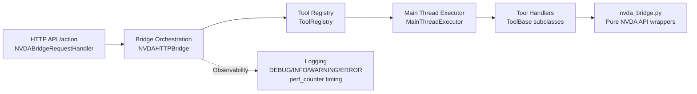

# Tool Registry Architecture (Auto-Discovery Edition)

## Overview

The NVDA MCP Bridge uses a layered architecture with a discoverable tool system:

- HTTP receives `{ "action": "tool_name", "params": {...} }`
- Bridge orchestrates validation, execution, timing, and envelopes
- Registry auto-discovers `ToolBase` implementations from `tools/`
- Main-thread executor guarantees NVDA API thread safety
- Tool handlers remain pure and protocol-agnostic

## Architecture Diagram



## Layer Responsibilities

| Layer | Responsibility | Returns | Error Contract |
|---|---|---|---|
| HTTP Handler | Parse/auth/respond | JSON HTTP response | HTTP status + bridge envelope |
| Bridge | Route + timing + envelope | `{"success": ...}` envelope | Catches exceptions and classifies |
| Registry | Validate + dispatch tool | Pure tool result | Raises `ValueError`/tool exceptions |
| Executor | Run on NVDA main thread | Pure callable result | Propagates raised exceptions |
| Tool Handlers | NVDA domain logic only | dict/list/primitive | Raise exceptions |

## Core Scaffolding

### 1) ToolBase + Metadata

```python
from dataclasses import dataclass, field
from abc import ABC, abstractmethod
from typing import Any, Dict, List


@dataclass(frozen=True)
class ToolMetadata:
    name: str
    description: str
    required_params: List[str] = field(default_factory=list)
    optional_params: List[str] = field(default_factory=list)
    version: str = "1.0.0"
    category: str = "general"


class ToolBase(ABC):
    @abstractmethod
    def metadata(self) -> ToolMetadata:
        raise NotImplementedError

    @abstractmethod
    def execute(self, **params: Any) -> Any:
        raise NotImplementedError

    def validate_params(self, params: Dict[str, Any]) -> None:
        metadata = self.metadata()
        for required in metadata.required_params:
            if required not in params:
                raise ValueError(f"Missing required parameter: {required}")
```

### 2) Auto-Discovery Mechanism

```python
import importlib
import inspect
import pkgutil


def auto_discover(self, tools_package):
    for module_info in pkgutil.iter_modules(tools_package.__path__):
        if module_info.ispkg:
            continue
        module = importlib.import_module(f"{tools_package.__name__}.{module_info.name}")
        for _, klass in inspect.getmembers(module, inspect.isclass):
            if klass.__module__ != module.__name__:
                continue
            if not issubclass(klass, ToolBase) or inspect.isabstract(klass):
                continue
            self.register_tool(klass())
```

### 3) Tool Registry

```python
class ToolRegistry:
    def register_tool(self, tool: ToolBase) -> ToolBase: ...
    def auto_discover(self, tools_package) -> int: ...
    def get(self, name: str) -> ToolBase | None: ...
    def execute(self, name: str, params: dict[str, Any]) -> Any: ...
    def list_tools(self) -> list[dict[str, Any]]: ...
    def freeze(self) -> None: ...
```

### 4) Main Thread Executor

```python
class MainThreadExecutor:
    def execute(self, func, *args, timeout=None, **kwargs):
        # queueHandler.queueFunction(queueHandler.eventQueue, ...)
        # wait for completion Event
        # return result or raise exception / TimeoutError
        ...
```

### 5) HTTP Endpoint / Bridge Orchestration

```python
def execute_action(self, action_name: str, params: dict[str, Any]) -> dict[str, Any]:
    start = time.perf_counter()
    try:
        result = self.executor.execute(self.registry.execute, action_name, params)
        duration_ms = (time.perf_counter() - start) * 1000
        if duration_ms > 500:
            log.warning("bridge.action.slow ...")
        else:
            log.info("bridge.action.success ...")
        return {"success": True, "action": action_name, "duration_ms": duration_ms, "result": result}
    except TimeoutError as e:
        return {"success": False, "action": action_name, "error_type": "timeout", "error": str(e)}
    except ValueError as e:
        return {"success": False, "action": action_name, "error_type": "validation", "error": str(e)}
    except Exception as e:
        return {"success": False, "action": action_name, "error_type": "execution", "error": str(e)}
```

## Request / Response Contract

### Example Request

```json
{
    "action": "speak_text",
    "params": {
        "text": "Hello from MCP Bridge"
    }
}
```

### Success Response

```json
{
    "success": true,
    "action": "speak_text",
    "duration_ms": 11.64,
    "result": {
        "spoken": "Hello from MCP Bridge"
    }
}
```

### Error Response

```json
{
    "success": false,
    "action": "move_focus",
    "duration_ms": 1.03,
    "error": "Missing required parameter: direction",
    "error_type": "validation"
}
```

## Adding a New Tool (Minimal Code)

Create a new file in `addon/globalPlugins/nvdaMcp-bridge/tools/`, for example `announce_time_tool.py`:

```python
from typing import Any
from ..tool_base import ToolBase, ToolMetadata
from .. import nvda_bridge


class AnnounceTimeTool(ToolBase):
    def metadata(self) -> ToolMetadata:
        return ToolMetadata(
            name="announce_time",
            description="Announce current time using NVDA speech",
            optional_params=["prefix"],
            version="1.0.0",
            category="speech",
        )

    def execute(self, **params: Any) -> Any:
        prefix = params.get("prefix", "Current time")
        return nvda_bridge.speak_text(f"{prefix}: 10:30")
```

No changes are needed in:

- `tool_registry.py`
- `default_tools.py`
- `nvda_http_bridge.py`

The new class is auto-discovered at startup.

## Testing & Debugging Strategy

- Tool unit tests: instantiate each `ToolBase` class and test `validate_params()` + `execute()` with NVDA APIs mocked.
- Registry tests: use synthetic tool classes and verify duplicate detection, discovery, and metadata output.
- Executor tests: mock `queueHandler.queueFunction` and assert result/timeout/exception propagation.
- HTTP endpoint tests: mock `ToolRegistry` and `MainThreadExecutor` to isolate transport concerns (status code, envelope, auth, JSON parsing).

## Why This Is Production-Ready

- Strong separation of concerns across transport, orchestration, dispatch, execution, and domain logic.
- Thread-safe NVDA access by mandatory main-thread execution.
- Observable actions via `time.perf_counter()` with slow-action warnings (`> 500ms`) and structured log events.
- Zero-touch extensibility through `ToolBase` auto-discovery.
- Tool metadata (`description`, `params`, `version`, `category`) supports documentation, introspection, and future permissions/policy layers.
